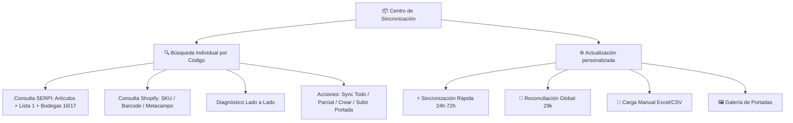

# 📦 Centro de Sincronización SERPI ERP ➔ Shopify

Plataforma integral para la auditoría, sincronización y conciliación automatizada del catálogo de productos, existencias físicas, listas de precios oficiales y metacampos entre el ERP **SERPI** y la tienda **Shopify** (Librería Troya).

Diseñado con una **arquitectura 100% *stateless* (sin estado local en disco)**, optimizado para ejecutarse en **Streamlit Cloud** con máxima ligereza, consultas en tiempo real y consumo mínimo de memoria RAM.

---

## 🔌 Especificación de APIs Integradas

### 1. APIs de SERPI ERP (`https://apis.serpi.com.co`)

La plataforma se conecta a tres endpoints maestros de SERPI utilizando autenticación por cabeceras (`secretkey` y `Authorization: Bearer <token>`):

| Endpoint | Propósito | Parámetros Principales de Consulta |
| :--- | :--- | :--- |
| **`/api/v1/Articulo`** | Fichas técnicas maestras, autor, editorial, presentación, páginas, categoría, estado y grupo contable. | `codigo`, `fechamodificaini`, `fechamodificafin`, `limite`, `pagina` |
| **`/api/v1/ListaPrecioDetalle`** | Lista de precios oficial para venta al público. | `idListaPrecio=1` (Lista PP), `codigo`, `fechamodificaini`, `fechamodificafin`, `limite`, `pagina` |
| **`/api/v1/SaldoInventarioSinCosto`** | Existencias físicas de inventario filtradas por bodega. | `idBodega` (16 o 17), `fechaCorte`, `codigo`, `fechamodificaini`, `fechamodificafin`, `limite`, `pagina` |

#### Nuevos Parámetros Incrementales (Deltas en Tiempo Real)
* **`fechamodificaini` y `fechamodificafin`:** Permiten consultar únicamente las novedades modificadas dentro de una ventana de tiempo (ej. últimas 24, 48 o 72 horas) con formato `YYYY-MM-DD hh:mm:ss`, procesando deltas en segundos en lugar de paginar 52.000 registros.
* **`idBodega`:** Permite filtrar las existencias directamente en los servidores de SERPI, consultando únicamente las bodegas autorizadas para la tienda web:
  * **Bodega Ventas (BG):** `idBodega = 16`
  * **Inventario en Consignación (CG):** `idBodega = 17`
  *(Las bodegas PDV, 2DOPISO, ANTERIOR, BX y BP quedan descartadas).*

---

### 2. APIs de Shopify Admin

La integración combina lo mejor de **GraphQL** para consultas complejas y metacampos, junto a **REST** para actualización de inventarios y carga binaria de portadas:

#### A. Shopify GraphQL Admin API (`/admin/api/2024-04/graphql.json`)
* **Búsqueda Jerárquica en Tiempo Real:** Localiza productos por coincidencia exacta en `SKU`, `Barcode` o en el metacampo `custom.serpi`.
* **`productVariantsBulkUpdate`:** Actualiza de forma atómica el precio de venta, código de barras y estado fiscal (taxable) de la variante.
* **`productCreate`:** Da de alta nuevos artículos en Shopify con su ficha técnica estructurada, etiquetas y metacampos.
* **`publishablePublish`:** Publica los productos en todos los canales de venta activos (Online Store, POS, Facebook & Instagram, Google, Shop).
* **GraphQL Bulk Operations:** Extracción masiva del catálogo completo (29.125 productos) en formato JSONL en ~30 segundos.

#### B. Shopify REST Admin API (`/admin/api/2024-04/`)
* **`/inventory_levels/set.json`:** Fija las existencias disponibles directamente en la sucursal activa (`Location`) de Shopify tras asegurar el seguimiento de inventario (`tracked: true`).
* **`/products/{id}/images.json`:** Carga y enlaza imágenes de portada enviando el archivo codificado en Base64 directamente al CDN de Shopify.

---

## 📐 Reglas de Negocio y Mapeo de Catálogo

| Atributo | SERPI ERP | Shopify | Regla de Transformación |
| :--- | :--- | :--- | :--- |
| **Identificador** | `codigo` | `SKU` / `Barcode` / `custom.serpi` | Normalizado sin comillas ni sufijos `.0`. |
| **Precio** | `precio` (Lista 1) | `variant.price` | Valor flotante redondeado a 2 decimales. |
| **Inventario** | Suma `saldo` en BG (16) y CG (17) | `inventory_level.available` | Solo existencias de BG y CG. Saldo negativo se normaliza a 0. |
| **Impuesto IVA** | `idgrupocontable == 10` | `variant.taxable: true` | Grupo 10 = Gravado 19% IVA. Libros (Grupo 2) = Exento IVA. |
| **Autor** | `camposPersonalizados.autor` | `vendor` y `custom.autor` | Se asigna a Vendor y al metacampo. |
| **Editorial** | `camposPersonalizados.editorial` | `productType` y `custom.editorial` | Se asigna a ProductType y al metacampo. |
| **Ficha Técnica** | `paginas`, `presentacion`, `estado` | `custom.*` | Mapeo automático al esquema de metacampos. |
| **Exclusiones** | Estado `'NUEVO E'` / `'USADO E'` | Excluido de creación | Libros categoría 'E' no se publican en Shopify. |

---

## 🖥️ Módulos de la Aplicación



1. **`🔍 Búsqueda Individual por Código` (Pestaña Principal):**
   * Permite ingresar cualquier código SKU/ISBN para contrastar en vivo los datos de SERPI frente a Shopify.
   * Diagnóstico visual de discrepancias (Precio, Stock, IVA, Ficha técnica, Portada).
   * Botón para sincronizar todo o seleccionar qué atributos actualizar (*Stock*, *Precio*, *IVA*, *Ficha*).
   * En caso de que el libro no exista en Shopify, permite crearlo con 1 clic y habilitar la subida inmediata de su portada.

2. **`⚡ Sincronización Rápida (Ventanas 24h/48h/72h)`:**
   * Utiliza las consultas delta (`fechamodificaini`) en las 3 APIs para procesar únicamente los cambios recientes en memoria.

3. **`🔄 Reconciliación Global (29k)`:**
   * Auditoría masiva de todo el catálogo cruzando los 29.125 productos de Shopify contra el catálogo maestro de SERPI en RAM.

4. **`📄 Carga Manual (Excel/CSV)`:**
   * Conciliación y actualización masiva a partir de planillas externas.

5. **`🖼️ Galería de Portadas`:**
   * Búsqueda por título o código para adjuntar imágenes al catálogo de Shopify.

---

## 🔐 Configuración de Variables de Entorno

Configurar las siguientes credenciales en `.env` (desarrollo local) o en **Streamlit Secrets** (Streamlit Cloud):

```toml
# SERPI ERP
SERPI_BASE_URL = "https://apis.serpi.com.co"
SERPI_SECRETKEY = "tu_secretkey_de_serpi"
SERPI_TOKEN = "tu_bearer_token_de_serpi"

# Shopify Store
SHOPIFY_SHOP_URL = "tu-tienda.myshopify.com"
SHOPIFY_API_TOKEN = "shpat_xxxxxxxxxxxxxxxxxxxxxxxxxxxxxxxx"
SHOPIFY_API_VERSION = "2024-04"
SHOPIFY_LOCATION_ID = "gid://shopify/Location/xxxxxxxx"
```

---

## 🚀 Despliegue y Ejecución Local

```bash
# 1. Clonar repositorio
git clone https://github.com/Fantasos23/Actualizacion-de-Archivos-Shopify.git
cd Actualizacion-de-Archivos-Shopify

# 2. Instalar dependencias
pip install -r requirements.txt

# 3. Iniciar aplicación
streamlit run app.py
```
